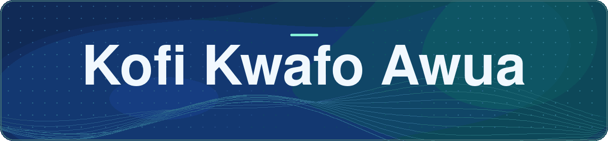

<!-- PROFILE README — Kofi Kwafo Awua -->

  <picture>
    <source media="(max-width: 560px)" srcset="./assets/kofi-profile-mobile.png">
    
  </picture>

<strong>Software Engineer · Tech Lead · Technology Educator</strong>

  <picture>
    <source media="(prefers-reduced-motion: reduce)" srcset="./assets/kofi-focus.png">
    
  </picture>

  
  
  

  
  
  

---

## ✨ About

I’m a **Software Engineer, Tech Lead and Technology Educator**. I lead end-to-end software delivery in financial services, from requirements to production, with a focus on transaction processing, reporting and integrations. My projects also connect engineering with education, accessibility and sustainability.

**Business and AI transformation.** I start with how people work. I map business rules and exceptions with the teams involved, prioritize AI opportunities by value and feasibility, and compare pilots with a baseline. I plan for human review, privacy, auditability and team training before rollout.

---

## 🚀 Selected Projects

### Mekasa · Communication through eye gaze

I started **Mekasa** after my father became ill and speaking became difficult for him. I wanted to find a way for us to keep communicating. That led me to build a prototype that uses a standard webcam to explore how someone could select a word or a phrase with their gaze.

Mekasa is a local prototype built with **Python, MediaPipe and OpenCV**. It uses face landmarks and gaze calibration to test whether holding your gaze on a tile can select a word. The [source and setup guide](https://github.com/Kkwafo/Mekasa/tree/development) and [ZIP download](https://github.com/Kkwafo/Mekasa/archive/refs/heads/development.zip) are available to repository collaborators. Public access is pending.

**Apache 2.0.** You’re welcome to use, modify and redistribute the code under the [Apache 2.0 terms](https://www.apache.org/licenses/LICENSE-2.0). If you’d like to test Mekasa locally or contribute, [get in touch](mailto:kofikwafoawua@gmail.com).

### More projects

| Project | What it does | Links |
| :--- | :--- | :--- |
| **SKEP** | A Python and FastAPI backend for an academic assistant that answers questions about uploaded PDFs and drafts lessons and teaching units. | [Source · `dev`](https://github.com/Kkwafo/skep-api/tree/dev) |
| **ALCA AgroTech** | A full-stack rebuild of an agricultural technology company’s site, with a responsive React interface and a Fastify contact API. | [Source · `development`](https://github.com/Kkwafo/alcaagrotech/tree/development) |
| **North Winds** | A Next.js site presenting the company’s wind and solar services, projects and contact information. | [Live site](https://northwinds.vercel.app/) · [Source](https://github.com/Kkwafo/North-Winds-Project-) |
| **KofiIsNotCoffeeApp** | A restaurant order management app with a kitchen queue, product catalog and sales reports exported to Excel. Built with Next.js, TypeScript, Prisma and PostgreSQL. | [Source](https://github.com/Kkwafo/KofiIsNotCoffeeApp) |
| **Spring AI Intro** | A Java 21 and Spring Boot example using Spring AI’s OpenAI integration. | [Source](https://github.com/Kkwafo/spring-ia-intro) |

---

## 🧰 Tech Stack

  <strong>Core</strong> 
  

  <strong>AI and Data</strong> 
  

I use **Python, PyTorch and TensorFlow/Keras** to prepare datasets, design and train neural networks, and evaluate models on data they haven’t seen. My applied AI work includes LLM assistants, retrieval-augmented generation (RAG), agents and tool calling. My technical toolkit also includes fine-tuning with Hugging Face and LoRA, local inference and experiment tracking.

  <strong>Databases</strong> 
   
  Also SQL Server

  <strong>Tools and Practices</strong> 
   
  Spring Batch · RabbitMQ · REST APIs · JUnit · Mockito · CI/CD

---

## 🎓 Teaching and Course Management

I design asynchronous learning experiences and research how teachers select digital tools for programming and robotics. I use AI to support lesson design and formative feedback, and teach students to verify claims, recognize bias and protect their data.

  
  
  
  
  
  
  

---

## 🎓 Education

| Degree | Institution |
| :--- | :--- |
| **Licenciatura en Tecnologías Educativas** · In progress | Universidad Tecnológica Nacional, Facultad Regional Córdoba (UTN-FRC) |
| **Profesor de Tecnología** | Instituto Superior de Profesorado Tecnológico |
| **Técnico en Industria Alimentaria** | Universidad Tecnológica Nacional, Córdoba |

---

## 🌍 Languages

  
  

---

<em>“Start where you are right now. Keep moving forward. Persevere always. 
This is what it means to live with purpose: advancing from this very moment.”</em>

