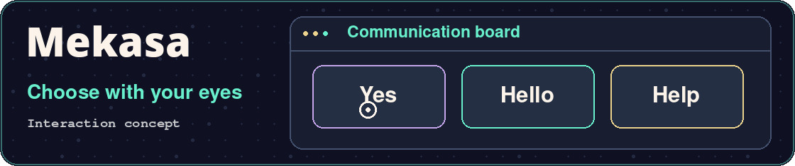
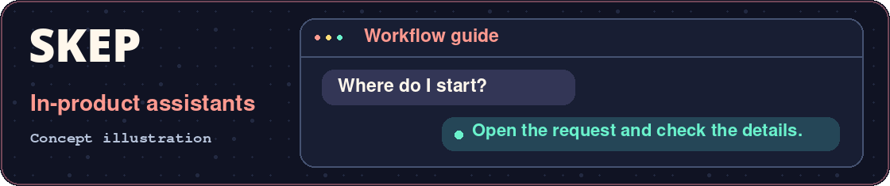

<!-- GitHub profile · Kofi Kwafo Awua -->

  <picture>
    <source media="(max-width: 560px)" srcset="./assets/workshop-mobile.png">
    
  </picture>

<h1 align="center">Hey, I’m Kofi 👋</h1>

<strong>Software Engineer · Tech Lead · Technology Educator</strong>

  <a href="https://www.linkedin.com/in/kofi-kwafo-awua-3b4350151/">LinkedIn</a> ·
  <a href="mailto:kofikwafoawua@gmail.com">Email</a> ·
  <a href="https://github.com/Kkwafo?tab=repositories">Repositories</a>

I lead software delivery in financial services and build AI tools that make work and learning easier. At my workbench, an assistant can show you the next step, and a prototype can help you say hello with your eyes.

## 🛠️ On the workbench

<strong>👁️ Mekasa</strong> · How would you say “Hello” with your eyes?

  <picture>
    <source media="(prefers-reduced-motion: reduce) and (max-width: 560px)" srcset="./assets/mekasa-mobile.png">
    <source media="(prefers-reduced-motion: reduce)" srcset="./assets/mekasa.png">
    <source media="(max-width: 560px)" srcset="./assets/mekasa-mobile.gif">
    
  </picture>

I’m prototyping a communication board with **Python and MediaPipe**. The animation shows the idea: hold your gaze on a tile long enough to select a word. I use facial landmarks to study gaze and test choices such as tile size and dwell time.

[Try the pointer simulation ↗](https://kkwafo.github.io/Kkwafo/#mekasa)

<strong>💬 SKEP</strong> · An AI guide that shows you what to do next

  <picture>
    <source media="(max-width: 560px)" srcset="./assets/skep-mobile.png">
    
  </picture>

I build **LLM assistants** that retrieve instructions and guide people through routine work. Structured outputs and tool calling connect the assistant to the product. The application checks permissions before running an action.

[Ask the simulated assistant ↗](https://kkwafo.github.io/Kkwafo/#skep)

<strong>🧩 Business and AI</strong> · Find a workflow worth improving

I turn business rules into transaction processing, reporting and integrations. For an AI pilot, I start with the people who do the work, check what data they have, then measure whether the pilot helps. For document review, I’d track turnaround time and rework, with human review, privacy and auditability built into the rollout.

[Compare two sample workflows ↗](https://kkwafo.github.io/Kkwafo/#business)

<strong><a href="https://kkwafo.github.io/Kkwafo/">Open the full interactive workshop ↗</a></strong>

## 🧰 Tools I use

  
  

**Software delivery.** Java, Spring Boot and Spring Batch, React, TypeScript, RabbitMQ, SQL Server, PostgreSQL, Docker and CI/CD.

**AI engineering.** I use Python to prepare datasets, design neural networks, train with PyTorch or TensorFlow/Keras, and test on examples the model has never seen. I also work with LLM agents, fine-tuning and model serving.

Open the toolbox

**AI and data.** NumPy, pandas, Jupyter, MediaPipe, FastAPI, Hugging Face Transformers, LoRA, multimodal and local inference, experiment tracking and MLOps.

**Web, databases and testing.** HTML, CSS, JavaScript, Next.js, Node.js, Redux, REST, GraphQL, MySQL, MongoDB, Firebase, JUnit, Mockito, Jest and Postman.

## 🎒 In the classroom

I design asynchronous learning experiences and study how teachers choose tools for programming and robotics. I use AI for lesson design and feedback, and teach students to check claims, look for bias and protect their data.

<strong>🔎 Mini challenge</strong> · Did the model spot a cat or a blue background?

Most cats in the training set had blue backgrounds. You have two new pictures: a cat on yellow and a dog on blue. Which one would help you catch the model taking a shortcut?

Reveal the answer

Use both. A model that recognizes the animal should identify the cat on yellow and reject the dog on blue. If it does the opposite, the background may be driving its prediction.

🎓 Teaching toolkit, education and languages

**Teaching.** Instructional design, curriculum, assessment, Moodle, Google Workspace, Canva, Genially and Google Antigravity.

**Education.** Licenciatura en Tecnologías Educativas (in progress, UTN-FRC), Profesor de Tecnología (Instituto Superior de Profesorado Tecnológico) and Técnico en Industria Alimentaria (UTN Córdoba).

**Languages.** Spanish (native) and [English (B2, EF SET)](https://cert.efset.org/hjt6Zb).

  
  
  

