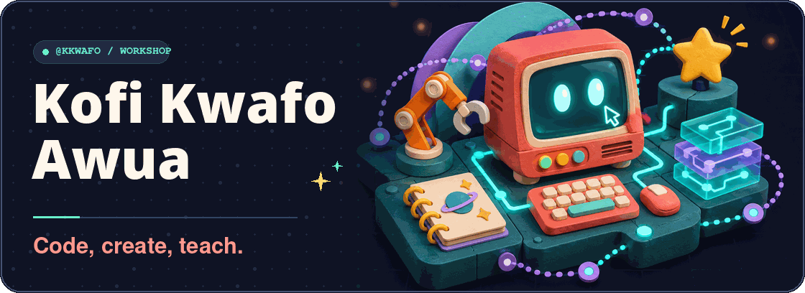

<!-- GitHub profile · Kofi Kwafo Awua -->

# Hey, I’m Kofi 👋

**Software Engineer · Tech Lead · Technology Educator**

I lead software delivery in financial services and build AI projects for two very different jobs: helping people get work done and making technology easier to use and learn.

[**Open the interactive workshop ↗**](https://kkwafo.github.io/Kkwafo/) · [LinkedIn](https://www.linkedin.com/in/kofi-kwafo-awua-3b4350151/) · [Email](mailto:kofikwafoawua@gmail.com) · [Repositories](https://github.com/Kkwafo?tab=repositories)

## What I build

**💬 SKEP** · AI assistants that guide people through a product and automate routine steps.

**👁️ Mekasa** · A Python and MediaPipe prototype for selecting words with your gaze.

**🧩 Business and AI** · I turn business rules into working software for transaction processing, reporting and integrations. For AI pilots, I start with the workflow and measure whether a change actually helps.

How these projects work

**SKEP.** I work with structured outputs, retrieval-augmented generation (RAG), embeddings and tool calling. A guided workflow can retrieve instructions and propose the next step while the application checks permissions.

**Mekasa.** I use landmarks around the face and eyes to estimate gaze. Dwell time, tile size and false selections shape how the interface feels to use.

**AI adoption.** I map the process with the people who do the work, prioritize by impact and feasibility, and compare a pilot with its baseline. For a document review pilot, I’d track turnaround time and rework, and plan for human review, privacy, auditability and training.

## Tools I use

**Software delivery.** Java, Spring Boot and Spring Batch, React, TypeScript, RabbitMQ, SQL Server, PostgreSQL, Docker and CI/CD.

**AI engineering.** Python, neural network design, training and evaluation with PyTorch and TensorFlow/Keras. I work across model and application layers, from datasets and held-out tests to LLM agents, fine-tuning and model serving.

Open the toolbox

**AI and data.** NumPy, pandas, Jupyter, MediaPipe, FastAPI, Hugging Face Transformers, LoRA, multimodal and local inference, experiment tracking and MLOps.

**Web, databases and testing.** HTML, CSS, JavaScript, Next.js, Node.js, Redux, REST, GraphQL, MySQL, MongoDB, Firebase, JUnit, Mockito, Jest and Postman.

## In the classroom

I design asynchronous learning experiences and study how teachers choose tools for programming and robotics. I use AI for lesson design and feedback, and teach students to check claims, look for bias and protect their data.

🔎 Try this. Did the model learn to spot a cat or a blue background?

Imagine that nearly every cat in your training set has a blue background. Show the model a cat on a yellow background and a dog on a blue one. If it calls the dog a cat, it may have learned to rely on the background. Use fresh examples to check, then improve the training set and test again.

🎓 Teaching toolkit, education and languages

**Teaching.** Instructional design, curriculum, assessment, Moodle, Google Workspace, Canva, Genially and Google Antigravity.

**Education.** Licenciatura en Tecnologías Educativas (in progress, UTN-FRC), Profesor de Tecnología (Instituto Superior de Profesorado Tecnológico) and Técnico en Industria Alimentaria (UTN Córdoba).

**Languages.** Spanish (native) and [English (B2, EF SET)](https://cert.efset.org/hjt6Zb).

  
