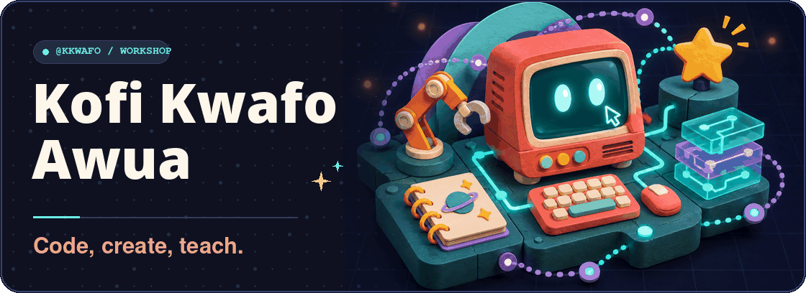
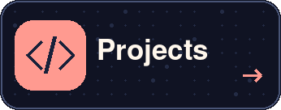
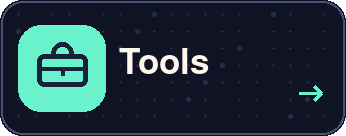
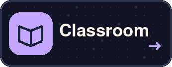
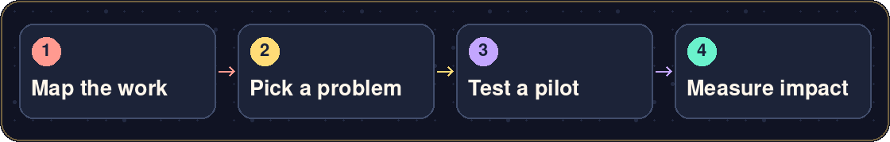
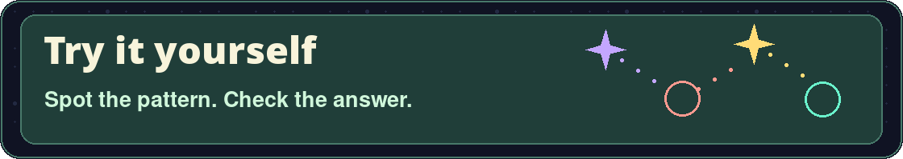
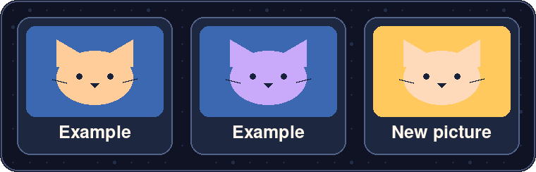
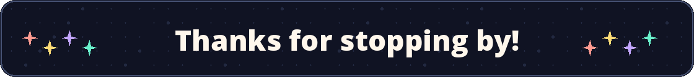

<!-- GitHub profile: Kofi Kwafo Awua -->

  <picture>
    <source media="(prefers-reduced-motion: reduce) and (max-width: 560px)" srcset="./assets/workshop-mobile.png">
    <source media="(prefers-reduced-motion: reduce)" srcset="./assets/workshop.png">
    <source media="(max-width: 560px)" srcset="./assets/workshop-mobile.gif">
    
  </picture>
  
<strong>Software Engineer · Tech Lead · Technology Educator</strong>

  

    
    
    
  

**Hey, I’m Kofi!** I build software, teach technology and like finding out what happens when the two meet. At work, I lead software delivery in financial services. In my workshop, I turn ideas into assistants, tools for learning and prototypes for more accessible communication. I like technology that saves people time and makes thoughtful use of resources.

  
  
  

## Projects

### 💬 SKEP · What if an app could show you the next step?

<picture>
  <source media="(max-width: 600px)" srcset="./assets/skep-mobile.png">
  
</picture>

I build **LLM-powered assistance inside the product** so people can find the next step and automate repetitive work.

🔧 Open SKEP’s project notes

I work with structured model outputs, retrieval-augmented generation (RAG), embeddings and tool calling. In a guided workflow, the assistant can retrieve instructions and suggest an action. The application checks access before running it. I evaluate answers using realistic tasks, checking whether they’re grounded, fast and practical to run.

### 👁️ Mekasa · Could you choose a word just by looking?

<picture>
  <source media="(prefers-reduced-motion: reduce) and (max-width: 600px)" srcset="./assets/mekasa-mobile.png">
  <source media="(prefers-reduced-motion: reduce)" srcset="./assets/mekasa.png">
  <source media="(max-width: 600px)" srcset="./assets/mekasa-mobile.gif">
  
</picture>

I’m prototyping **gaze-based communication** with **Python and MediaPipe**. The prototype detects face landmarks. The animation illustrates the interaction I’m building, where holding your gaze on a tile can select a word.

🔧 Open Mekasa’s project notes

The camera gives me a stream of frames. MediaPipe estimates landmarks around the face and eyes. I use those points to investigate how to estimate gaze and measure fixation. Choice size, timing and false selections matter as much as the model.

### 🧩 Business and AI transformation · Where would AI actually help?

<picture>
  <source media="(max-width: 600px)" srcset="./assets/process-mobile.png">
  
</picture>

In financial services, I turn business rules and exceptions into software for transaction processing, reporting and integrations. I bring that approach to AI adoption. For an internal document review pilot, I’d first measure how long reviews take and how often they need rework. Then I’d test the assistant with people who do the work and decide whether the results justify rollout.

🔧 Open the rollout checklist

Map the current workflow with its owners, check the available data and pick a use case based on value and feasibility. Test with a baseline and agree on human review, permissions, privacy and auditability. If the pilot improves the workflow, prepare team training, monitoring and a plan for scaling.

## Technology Stack

| What I’m building | Tools |
| :--- | :--- |
| **🖥️ Software people use** Java 17/21, Spring Boot, React, TypeScript, Next.js |  |
| **🐍 Models and AI features** Python, PyTorch, TensorFlow/Keras, FastAPI |  |
| **📦 Data and delivery** PostgreSQL, MongoDB, MySQL, Docker, Git |  |

**From examples to a model.** I prepare datasets, design neural networks, train them with PyTorch or TensorFlow/Keras and test them on examples held out from training. I compare architectures and inspect where they get things wrong.

🧰 Open the rest of the toolbox

**AI engineering** · Python, NumPy, pandas, Jupyter, MediaPipe and FastAPI. Deep learning, model evaluation, embeddings, RAG, LLM agents, Hugging Face Transformers, LoRA fine-tuning, multimodal and local inference, and MLOps for tracking experiments, versioning models and monitoring quality.

**Software delivery** · Spring Batch, RabbitMQ, SQL Server, PostgreSQL, MySQL, MongoDB, Firebase, REST, GraphQL, HTML, CSS, JavaScript, Node.js, Redux, Postman, JUnit, Mockito, Jest, Git and CI/CD.

## Classroom

I design asynchronous learning experiences and research how teachers choose digital tools for programming and robotics. I bring AI into lesson planning, formative feedback and accessible learning support, and teach students to verify answers and think about bias and privacy.

🔎 Try it · How does a neural network learn a pattern?

Imagine sorting drawings into two piles: cats and dogs. During training, the model guesses, checks each guess against the label and adjusts its internal weights. Then you show it a new pile it hasn’t seen. What happens if most cats in the first pile had a blue background? The new pile can help you spot whether the model learned to recognize cats or relied on the background.

🕵️ Try it · How would you check an AI answer?

Ask an AI for two facts about the Moon. Pick one fact and find it in a source you trust, such as NASA. Can you point to the exact sentence or image that supports the claim? If you can’t, what would you need to check next?

**🎨 Teaching toolkit** · Curriculum planning, instructional design and assessment.

  
  
  
  
  

🎓 Education and languages

| Program | Institution |
| :--- | :--- |
| Licenciatura en Tecnologías Educativas · In progress | Universidad Tecnológica Nacional, Facultad Regional Córdoba (UTN-FRC) |
| Profesor de Tecnología | Instituto Superior de Profesorado Tecnológico |
| Técnico en Industria Alimentaria | Universidad Tecnológica Nacional, Córdoba |

  
  

  
  

    
    
    
  

  
<em>Start where you are right now. Keep moving forward. Persevere always. 
  This is what it means to live with purpose: advancing from this very moment.</em>

