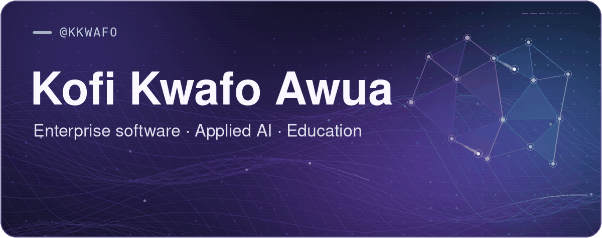
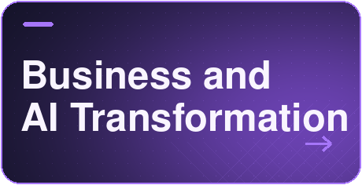
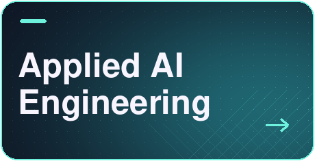
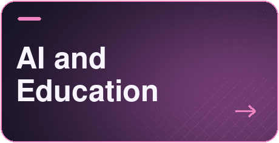

  <picture>
    <source media="(prefers-reduced-motion: reduce)" srcset="./assets/profile-banner.png">
    
  </picture>
  <h1>Software Engineer · Tech Lead · Technology Educator</h1>
  

    <a href="https://www.linkedin.com/in/kofi-kwafo-awua-3b4350151/"><strong>LinkedIn</strong></a>
    &nbsp;·&nbsp;
    <a href="mailto:kofikwafoawua@gmail.com"><strong>Email</strong></a>
    &nbsp;·&nbsp;
    <a href="#selected-work"><strong>Selected work</strong></a>
  

I’m a **Software Engineer, Tech Lead and Technology Educator**. I lead enterprise software delivery in financial services and apply **Python, computer vision and generative AI** in projects for accessible communication and workflow automation. My technical background includes **neural network design, training and evaluation**.

  
  
  

## Business and AI Transformation

- **Understand the process.** Work with stakeholders to map business rules, bottlenecks and exceptions. Translate that into requirements and a roadmap.
- **Prioritize use cases.** Assess value, feasibility, data readiness and risk. Define how to measure a pilot, such as turnaround time for document review or first-contact resolution for internal support.
- **Pilot and scale.** Compare outcomes with a baseline. Plan for adoption, training, human review, access, privacy and auditability.

## Applied AI Engineering

- **Python and deep learning.** Prepare datasets, design neural networks, and train and validate models with **PyTorch** and **TensorFlow/Keras**. Compare architectures and analyze errors on held-out data.
- **Generative AI.** Build LLM assistants with structured outputs, retrieval-augmented generation (RAG), embeddings and agents that call existing APIs. Apply these techniques to workflows such as in-product guidance and routine task automation.
- **Model adaptation and delivery.** Fine-tune open-weight models with **Hugging Face Transformers** and **LoRA**. Work with multimodal models, local inference and model serving with **FastAPI**, with attention to quality, latency and cost.
- **MLOps.** Track experiments, version datasets and models, and set up repeatable evaluation and monitoring for deployment.

## AI and Education

- **Teach with AI.** Design asynchronous learning experiences and explore conversational tutors, formative feedback and accessible support. Evaluate each tool against the learning objectives.
- **Teach about AI.** Help learners understand how models generate responses, verify claims and sources, recognize bias and protect personal data.
- **Support educators.** Connect AI literacy to teacher training, curriculum planning and assessment. My research examines how teachers choose digital tools for programming and robotics.

## Selected Work

**SKEP** · LLM-powered features for in-product guidance and workflow automation.

**Mekasa** · A **Python** prototype for gaze-based communication, using **MediaPipe** face landmarks to inform gaze tracking.

**Financial services** · Enterprise batch processing and integrations, from business requirements to delivery across teams.

## Technology Stack

**Enterprise** · `Java 17/21` `Spring Boot` `Spring Batch` `React` `TypeScript` `RabbitMQ` `SQL Server` `PostgreSQL` `Docker` `CI/CD`

**AI and data** · `Python` `Jupyter` `NumPy` `pandas` `PyTorch` `TensorFlow/Keras` `MediaPipe` `FastAPI`

<strong>Additional tools</strong>

- **Web and testing** · HTML, CSS, JavaScript, Next.js, Node.js, Redux, GraphQL, Jest, JUnit, Mockito, Git and Postman
- **Data** · MySQL, MongoDB and Firebase
- **Teaching and collaboration** · Moodle, Google Workspace, Canva, Genially and Google Antigravity

## Education and Languages

- **Licenciatura en Tecnologías Educativas** · Universidad Tecnológica Nacional, Facultad Regional Córdoba (UTN-FRC) · In progress
- **Profesor de Tecnología** · Instituto Superior de Profesorado Tecnológico
- **Técnico en Industria Alimentaria** · Universidad Tecnológica Nacional, Córdoba

**Spanish** · Native &nbsp;&nbsp; **English** · B2 ([EF SET certificate](https://cert.efset.org/hjt6Zb))

> Start where you are right now. Keep moving forward. Persevere always.  
> This is what it means to live with purpose: advancing from this very moment.
